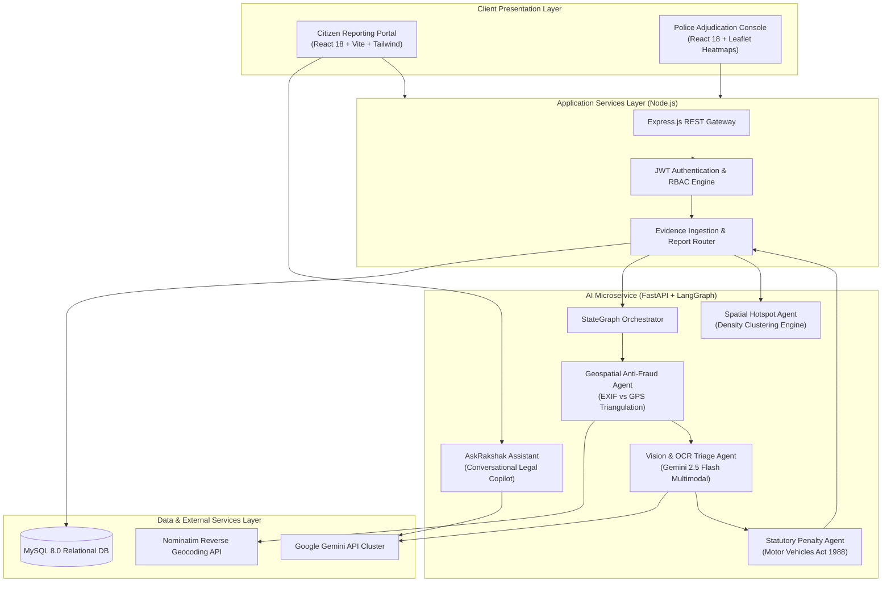
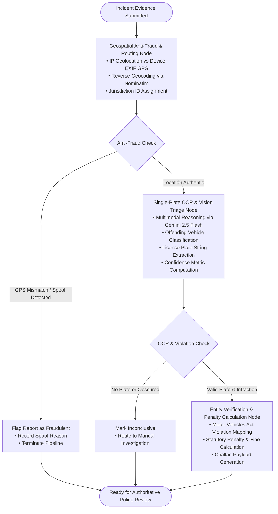
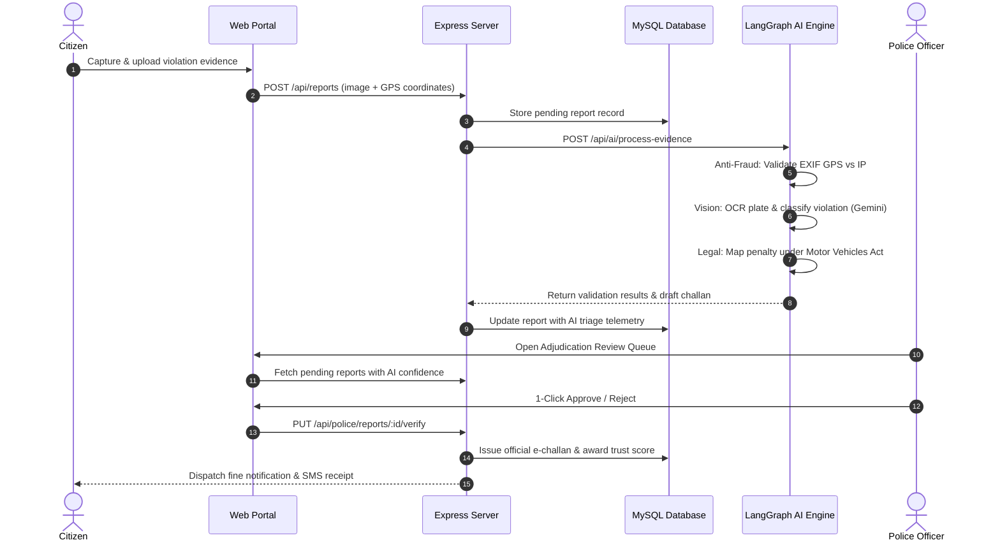

<h2 align="center"><b>multimodal-traffic-inference</b></h2>

<h4 align="center">Distributed multi-agent visual reasoning and automated transit enforcement platform</h4>

<p align="center">
    <a href="https://github.com/yuvanvishnupandi/multimodal-traffic-inference"></a>
    <a href="https://margarakshak-xi.vercel.app/"></a>
    <a href="LICENSE"></a>
    
    
    
    
    
    
    
    
    
</p>

---

Implementation of a distributed multi-agent vision-language architecture for automated traffic violation detection, spatial fraud mitigation, and statutory penalty adjudication. Powered by LangGraph, Google Gemini Vision, and FastAPI, coupled with a Node.js Express backend, MySQL 8.0 relational schema, and React frontend.

The platform processes crowdsourced incident evidence, triangulates spatial authenticity, performs optical recognition on vehicle license plates, identifies regulatory infractions under the Motor Vehicles Act, and provides police officers with an authoritative adjudication console for rapid 1-click verification.

---

## Architecture

The system decouples user interaction, core business logic, relational storage, and multi-agent artificial intelligence into modular, independently scalable tiers:



---

## Multi-Agent Execution Graph

The core inference engine executes as a stateful, cyclic directed graph using LangGraph. Each specialized agent inspects, modifies, and enriches the shared `AgentState` before routing to subsequent nodes:



### Agent Specialization Matrix

| Agent | Technology | Primary Function | Failure Mode / Fallback |
|:---|:---|:---|:---|
| **Geospatial Anti-Fraud** | Geopy / Nominatim | Cross-validates device hardware GPS coordinates against client IP geolocation with 50km tolerance | Bypasses network check if GPS metadata unavailable |
| **Vision & OCR Triage** | Google Gemini 2.5 Flash | Isolates single vehicle, reads license plate alphanumeric characters, detects violation type | Cascades: `gemini-2.5-flash` → `gemini-2.0-flash` → `gemini-flash-latest` |
| **Statutory Rule Engine** | Python / SQL Rules | Maps detected offense string to codified Indian Motor Vehicles Act sections and calculates standard fine amounts | Applies baseline general safety fine if specific section unmatched |
| **AskRakshak Assistant** | LangChain / Multi-LLM | Conversational copilot answering citizen legal inquiries and providing challan contest guidance | Fallback chain: Google Gemini → OpenAI GPT-4o-mini → Mistral AI |
| **Hotspot Prediction** | Scikit-Learn / Leaflet | Aggregates geographic report clusters to project traffic violation density heatmaps | Returns global regional hotspot coordinates if density under threshold |

---

## Traffic Violation Enforcement Workflow

The complete lifecycle from citizen crowdsourced evidence capture to official fine issuance and penalty settlement:



---


## Install

### Prerequisites

- Python 3.11+
- Node.js 18+ and npm
- MySQL Server 8.0+
- Google Gemini API Key

### Repository Setup

```bash
# Clone the repository
$ git clone https://github.com/yuvanvishnupandi/multimodal-traffic-inference.git
$ cd multimodal-traffic-inference

# 1. AI Microservice Environment
$ cd ai_service
$ python -m venv venv
$ source venv/bin/activate  # On Windows: .\venv\Scripts\activate
$ pip install -r requirements.txt

# 2. Node.js Backend Gateway
$ cd ../backend
$ npm install

# 3. React Frontend Dashboard
$ cd ../frontend
$ npm install
```

### Database Initialization

```bash
$ mysql -u root -p -e "CREATE DATABASE traffic_violation_db;"
$ mysql -u root -p traffic_violation_db < backend/database_schema.sql
```

### Environment Configuration

Configure `ai_service/.env`:

```env
GEMINI_API_KEY=your_gemini_api_key
OPENAI_API_KEY=your_openai_api_key
MISTRAL_API_KEY=your_mistral_api_key
```

Configure `backend/.env`:

```env
PORT=5000
DB_HOST=localhost
DB_USER=root
DB_PASSWORD=your_password
DB_NAME=traffic_violation_db
JWT_SECRET=your_jwt_secret_hash
AI_SERVICE_URL=http://localhost:8000
```

---

## Usage

### Programmatic Multi-Agent Pipeline

Invoke the LangGraph state machine directly from Python:

```python
from ai_service.models import EvidencePayload, LocationData
from ai_service.agents import build_graph

# Compile the multi-agent graph
graph = build_graph()

# Construct report evidence payload with spatial telemetry
payload = EvidencePayload(
    user_id = "citizen_4021",
    image_url = "https://example.com/incident_evidence.jpg",
    device_gps = LocationData(lat = 12.9716, lng = 77.5946),
    ip_address = "106.51.72.10"
)

# Run end-to-end multi-agent evaluation
state = graph.invoke({
    "agent_state": {
        "payload": payload
    }
})

result = state["agent_state"]

print(f"Anti-Fraud Flag:    {result.is_fraud}")
print(f"Jurisdiction:       {result.jurisdiction_id}")
print(f"Detected Plate:     {result.vision_validation.extracted_plate}")
print(f"Violation:          {result.vision_validation.violation_detected}")
print(f"Vision Confidence:  {result.vision_validation.confidence_score}%")
print(f"Assessed Penalty:   ₹{result.final_challan.fine_amount}")
```

### Launching System Services

Run all services simultaneously using the provided Windows script:

```cmd
start.bat
```

Or launch services independently:

```bash
# Terminal 1 — AI Microservice (FastAPI)
$ cd ai_service
$ uvicorn main:app --host 0.0.0.0 --port 8000 --reload

# Terminal 2 — Application Gateway (Express)
$ cd backend
$ npm start

# Terminal 3 — Interactive Client (Vite)
$ cd frontend
$ npm run dev
```

### API Ingestion Endpoints

#### 1. Submit Evidence for Autonomous Multi-Agent Triage

```bash
$ curl -X POST "http://localhost:8000/api/ai/process-evidence" \
    -H "Content-Type: application/json" \
    -d '{
        "user_id": "citizen_4021",
        "image_url": "https://example.com/evidence.jpg",
        "device_gps": {"lat": 12.9716, "lng": 77.5946},
        "ip_address": "106.51.72.10"
    }'
```

```json
{
  "status": "success",
  "is_fraud": false,
  "fraud_reason": null,
  "vision_validation": {
    "is_valid_submission": true,
    "license_plate_found": true,
    "extracted_plate": "TN01AB1234",
    "violation_detected": "Driving without a Helmet",
    "confidence_score": 96,
    "auto_approve": true
  },
  "challan": {
    "challan_id": "CH-928174",
    "plate_number": "TN01AB1234",
    "violation_type": "Driving without a Helmet",
    "fine_amount": 1000.0,
    "currency": "INR",
    "jurisdiction_id": "JURISDICTION_BANGALORE_URBAN",
    "status": "ISSUED"
  },
  "jurisdiction_id": "JURISDICTION_BANGALORE_URBAN"
}
```

#### 2. AskRakshak Legal Copilot Query

```bash
$ curl -X POST "http://localhost:8000/api/ai/chat" \
    -H "Content-Type: application/json" \
    -d '{
        "message": "I received a red light challan at 10:14 AM on Anna Salai but my vehicle was parked.",
        "mode": "citizen",
        "current_path": "/dispute"
    }'
```

#### 3. Spatial Hazard & Hotspot Density Extraction

```bash
$ curl -X GET "http://localhost:8000/api/ai/heatmap"
```

---

## Citations

```bibtex
@article{team2023gemini,
    title   = {Gemini: A Family of Highly Capable Multimodal Models},
    author  = {Gemini Team and Google},
    journal = {arXiv preprint arXiv:2312.11805},
    year    = {2023}
}
```

```bibtex
@misc{langgraph2024,
    title   = {LangGraph: Building Stateful Multi-Agent Applications with LLMs},
    author  = {LangChain Team},
    year    = {2024},
    url     = {https://github.com/langchain-ai/langgraph}
}
```

```bibtex
@article{dosovitskiy2020image,
    title   = {An Image is Worth 16x16 Words: Transformers for Image Recognition at Scale},
    author  = {Alexey Dosovitskiy and Lucas Beyer and Alexander Kolesnikov and Dirk Weissenborn and Xiaohua Zhai and Thomas Unterthiner and Mostafa Dehghani and Matthias Minderer and Georg Heigold and Sylvain Gelly and Jakob Uszkoreit and Neil Houlsby},
    journal = {Proceedings of the International Conference on Learning Representations (ICLR)},
    year    = {2021}
}
```

---

## License

[MIT](LICENSE)

